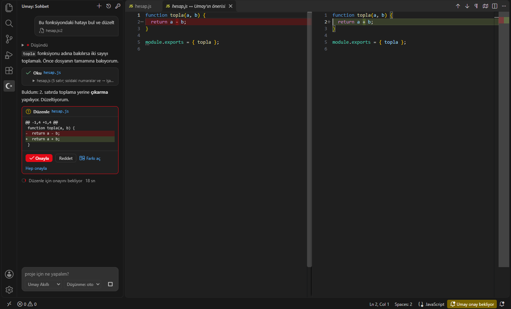

# ☾★ Umay: Türkçe Yapay Zeka Kod Asistanı

Türkiye'nin bağımsız yapay zekası [Umay](https://umayzeka.com), artık editörünün içinde. Umay projendeki dosyaları okur, hatayı bulur, düzeltmeyi önerir, testleri çalıştırır; **her değişiklik ve komut için önce onayını ister.**

## Kurulum: üç adım

1. **Eklentiyi kur.** Eklentiler (Ctrl+Shift+X) bölümünde **Umay** ara ve **Yükle**'ye bas.
2. **Anahtarını gir.** Umay paneli kendiliğinden açılır. [umayzeka.com](https://umayzeka.com) → Geliştirici & API Paneli → Yeni Anahtar Oluştur ile aldığın `umay-sk-...` anahtarını yapıştır. Umay CLI kullanıyorsan **Umay CLI'deki anahtarı kullan** düğmesine basman yeter.
3. **Yaz.** "Bu projeyi anlat", "şu hatayı düzelt", "bu dosyaya test yaz"...

Başka bir şey kurmana gerek yok: Python, Node.js veya Umay CLI gerekmez.

**Cursor, Windsurf, VSCodium ve benzerleri:** Eklenti [Open VSX](https://open-vsx.org)'te de yayınlanır; bu editörlerin eklenti bölümünde **Umay** araman yeterli. Elinde `.vsix` dosyası varsa: Eklentiler bölümü → `···` → **Install from VSIX...** (veya dosyayı eklentiler bölümüne sürükle bırak).

## Neler yapar

- **Sohbet:** Umay'ın tüm modelleri (Umay Akıllı, Hızlı, Ultra Hızlı, Mistral, DeepSeek...), canlı yazım, açılır kapanır düşünce, Markdown, tablolar ve kod blokları. Liste Umay'dan gelir; yeni model eklenince eklentiyi güncellemek gerekmez.
- **Projende çalışır:** Açık klasördeki dosyaları okur, listeler, arar, yazar ve düzenler; PowerShell (Windows) veya sh komutu ve Python çalıştırır; sunucu gibi bitmeyen işleri arka planda başlatıp adresini gösterir.
- **Önce sorar:** Her yazma ve komut, onay kutusunda farkıyla gösterilir. **Farkı aç** değişikliği VS Code'un yan yana karşılaştırmasında açar. **Onayla**, **Reddet** veya **Hep onayla** (o sohbet için). Son değişiklik tek tıkla geri alınır.
- **Ne gördüğünü bilir:** Açık dosya ve seçtiğin kod mesaja kendiliğinden eklenir; mesaj kutusunun üstündeki etikete tıklayıp o mesaj için kapatabilirsin.
- **Sağ tık menüsü:** Kod seç, sağ tıkla → **Umay** → *Bu kodu açıkla*, *Hataları bul ve düzelt*, *Test yaz*, *Açıklama satırları ekle*, *Umay'a sor...*
- **Hata ampulü:** Kırmızı veya sarı altı çizili her satırda ampul menüsünde (Ctrl+.) **☾★ Umay ile düzelt**.
- **Kod blokları:** Yanıttaki her kod bloğunda **Kopyala** ve **Editöre ekle** (seçili kodun yerine ya da imlecin olduğu yere).
- **Geçmiş:** Sohbetler saklanır; panelin üstündeki saat simgesiyle eskilerine dönebilirsin.

## Komutlar ve kısayollar

| Ne | Nasıl |
| --- | --- |
| Umay'ı aç | `Ctrl+Alt+U` (macOS'ta `Cmd+Alt+U`) veya sol çubuktaki ☾ simgesi veya durum çubuğundaki **☾★ Umay** |
| Yeni sohbet, geçmiş, anahtar | Umay panelinin başlığındaki `+`, saat ve anahtar simgeleri |
| Seçili kodla ilgili iş | Sağ tık → **Umay** |
| Hata düzeltme | Hatalı satırda `Ctrl+.` → **Umay ile düzelt** |
| Son dosya değişikliğini geri al | Yanıtın altındaki **Son değişikliği geri al** veya komut paletinde *Umay: Son dosya değişikliğini geri al* |
| Gönder / yeni satır | `Enter` / `Shift+Enter` |

## Güvenlik ve gizlilik

- **Anahtar** işletim sisteminin güvenli kasasında (Windows Kimlik Bilgisi Yöneticisi, macOS Anahtar Zinciri, Linux'ta libsecret) saklanır ve sohbet paneline hiç inmez. Hiç anahtar kaydedilmemişse `UMAY_API_KEY` ortam değişkeni kullanılır.
- **Dosya araçları yalnızca açık klasörün içinde** çalışır; klasör dışına çıkan yollar ve klasör dışına giden bağlantılar reddedilir.
- **Komutlar yalıtılmış değildir.** Neyin çalışacağı onay kutusunda gösterilir; onaylamadan önce oku. Ayarlardan onaysız çalıştırma açılabilir, varsayılan olarak kapalıdır.
- **Güvenilmeyen klasörlerde** (Workspace Trust) Umay yalnızca sohbet eder; dosya okuma, yazma ve komutlar kapalıdır.
- **Kaydedilmemiş değişiklikleri olan bir dosyanın üzerine yazılmaz.** Mesaj gönderilmeden önce açık dosyalar kaydedilir (ayarlardan kapatılabilir), böylece Umay ekrandakini görür.
- Okunan dosyalar, seçili kod ve komut çıktıları, Umay'ın yanıt verebilmesi için Umay API'ye (umayzeka.com) gönderilir. Şifre veya kimlik bilgisi içeren dosyaları paylaşmamaya dikkat et.

## Ayarlar

| Ayar | Varsayılan | Açıklama |
| --- | --- | --- |
| `umay.includeActiveFile` | açık | Açık dosyanın adını ve seçili kodu mesaja ekle |
| `umay.saveBeforeSend` | açık | Göndermeden önce kaydedilmemiş dosyaları kaydet |
| `umay.autoApprove.writes` | kapalı | Dosya değişikliklerini onay sormadan uygula |
| `umay.autoApprove.commands` | kapalı | Komutları onay sormadan çalıştır |
| `umay.baseUrl` | `https://umayzeka.com/v1` | Gelişmiş: API adresi (HTTPS; yalnızca localhost için HTTP) |

## Sık sorulanlar

**Ücretli mi?** Eklenti ücretsizdir. İstekler Umay API anahtarınla yapılır; kota ve kullanım koşulları umayzeka.com'daki hesabına bağlıdır.

**Uzak bağlantıda (SSH, WSL, Dev Container) çalışır mı?** Eklenti dosyaların bulunduğu tarafta çalışacak biçimde ayarlıdır: uzak bir klasör açıkken araçlar uzak makinedeki klasörde çalışır.

**Umay bir şeyi yarıda bıraktı.** Uzun işlerde en fazla 25 adım atılır; "devam et" yazınca kaldığı yerden sürdürür. Durdur düğmesiyle (mesaj kutusundaki kare) istediğin an kesebilirsin; yapılanlar sohbette kalır.

**Dosyayı yarım yazdı.** Umay'ın yanıtları yaklaşık 24 KB'ta kesilir. Eklenti uzun dosyaları parça parça yazdırır ve kesilen bir yazmanın tamamlanmış kısmını kurtarır.

## Diğer Umay uygulamaları

- [Umay CLI](https://github.com/Umay-Official/Umay-CLI): terminalde Umay; PowerPoint, Word, Excel ve şema üretimi.
- Umay Code: Windows için masaüstü kodlama uygulaması.

## Lisans

PolyForm Noncommercial License 1.0.0 ve Umay için ek izin ([LICENSE](LICENSE)). Kişisel, eğitim, araştırma ve kâr amacı gütmeyen kullanım serbesttir. Kaynaklar ve bağımlılıklar: [NOTICE.md](NOTICE.md).

Copyright (c) 2026 Eray Çiçek
